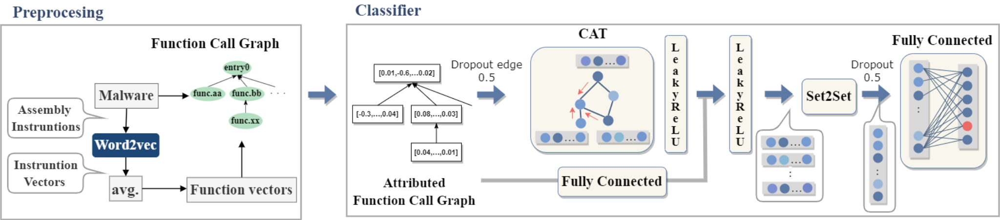

# FCGAT

**FCGAT** is an interpretable malware classification method using **Function Call Graph (FCG)** and an **attention mechanism**.

This repository is the **public source-code release** for the BAR 2023 paper:

- *FCGAT: Interpretable Malware Classification Method using Function Call Graph and Attention Mechanism*
  Paper: https://bar2023.github.io/2023papers/5/bar2023-final5.pdf

---

## Method overview



---

## What this repo provides

- IDA Pro (IDAPython) scripts to export:
  - Function Call Graphs (DOT)
  - per-function disassembly token sequences
- Python scripts to build a **PyTorch Geometric** graph dataset
- Word2Vec (CBOW) training and feature embedding for functions
- A PyTorch Geometric implementation of **FCGAT**:
  - GAT convolution on reverse-FCG
  - Set2Set readout that returns per-node attention weights
  - Function-importance ranking as an explanation

---

## Repository layout

```
.
├── ida_scripts/                 # Run inside IDA Pro
├── scripts/                     # Dataset building / embedding
├── src/fcgat/                   # FCGAT model + training/eval utilities
├── datasets/                    # Hash lists only (NO malware binaries)
├── examples/                    # Example label file format etc.
├── tests/                       # Minimal unit tests
├── requirements.txt
├── environment.yml
└── README.md
```

---

## Environment setup

The procedure for setting up the environment using Conda is as follows.

> Note: **IDA Pro / IDAPython is not installed by Conda.**  
> The scripts in `ida_scripts/` are intended to be executed in an environment where IDA Pro is already installed.

### Create the environment (CUDA)

Create an environment from `environment.yml` (configured for CUDA builds via `pytorch-cuda=11.8`):

```bash
conda env create -f environment.yml
conda activate fcgat

# Install this repo as an editable package
pip install -e .
```

- If you need a different CUDA version, edit `pytorch-cuda=11.8` in `environment.yml`.

### Sanity check

```bash
python -c "import torch, torch_geometric; print('torch', torch.__version__); print('pyg', torch_geometric.__version__)"
```

---

## Quickstart

### 1) Export graphs and function tokens with IDA Pro

1. Create IDB/I64 files from malware samples.
2. Export:
   - FCG as DOT: `ida_scripts/export_fcg.py`
   - function token data: `ida_scripts/export_function_data.py`

See `ida_scripts/README.md` for headless command examples.

### 2) Build a raw graph dataset

```bash
python scripts/build_graph_dataset.py \
  --fcg_dir path/to/fcg_dot/ \
  --functiondata_dir path/to/functiondata_pkl/ \
  --labels_csv examples/labels_example.csv \
  --out_dir data/graphs_raw
```

### 3) Train Word2Vec and embed graphs

```bash
python scripts/train_word2vec.py \
  --graphs_raw_dir data/graphs_raw \
  --out_model artifacts/word2vec.model

python scripts/embed_graph_dataset.py \
  --graphs_raw_dir data/graphs_raw \
  --word2vec_model artifacts/word2vec.model \
  --out_dir data/graphs_emb
```

### 4) Train FCGAT

```bash
python -m fcgat.train \
  --data_dir data/graphs_emb \
  --out_dir artifacts/run1 \
  --epochs 700 \
  --batch_size 256 \
  --lr 1e-3
```

### 5) Predict & explain (function importance ranking)

```bash
python -m fcgat.explain \
  --checkpoint artifacts/run1/model.pt \
  --graph_pt data/graphs_emb/<sha256>.pt \
  --top_k 20
```

---

## Datasets (hash lists only)

This repository includes **only hash lists** for datasets (no binaries):

- `datasets/sha256_MalwareBazaar.txt`
- `datasets/sha256_BODMAS.txt`

You must obtain binaries from the original sources under their terms.

---

## Citation

If you use this code in academic work, please cite:

```bibtex
@inproceedings{fcgat2023,
  title     = {FCGAT: Interpretable Malware Classification Method using Function Call Graph and Attention Mechanism},
  author    = {Someya, Minami and Otsubo, Yuhei and Otsuka, Akira},
  booktitle = {Workshop on Binary Analysis Research (BAR)},
  year      = {2023}
}
```

---

## License

This repository template ships with the MIT license (see `LICENSE`).
